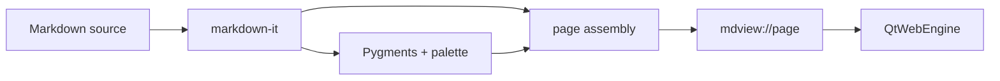

# MDView Demo

A tour of everything the renderer does — all of it offline, from assets
shipped on disk.

## Links & images

Normal links open in your browser: [CommonMark](https://commonmark.org),
[Mermaid](https://mermaid.js.org) and [KaTeX](https://katex.org) — same-window
navigation only ever happens inside `mdview://`. Images are served from this
document's folder:


## Math (KaTeX, local)

Inline math like $e^{i\pi} + 1 = 0$ and display math:

$$
\int_0^\infty e^{-x^2}\,dx = \frac{\sqrt{\pi}}{2}
$$

## GitHub-flavoured Markdown

| Feature | Where |
| --- | --- |
| Tables | this one |
| Task lists | below as checkboxes |
| ~~Strikethrough~~ | this row |
| `inline code` | everywhere |

> Italic body at full contrast, accent rule, muted attribution line.
> — the style guide

- [x] Multi-tab editing of the same document reloads cleanly
- [x] Palette changes apply without losing scroll position
- [ ] World domination

## Highlighted code (Pygments, recoloured by the active palette)

```python
from dataclasses import dataclass


@dataclass(frozen=True, slots=True)
class FontSize:
    size_px: int = 16  # clamped 10–32

    def percent(self) -> int:
        return round(self.size_px / 16 * 100)
```

## Diagrams (Mermaid, local)


